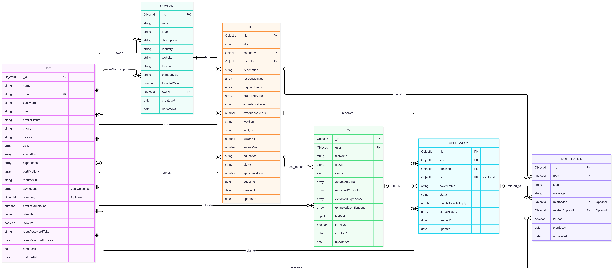

# GradLink

GradLink is a MERN job portal project. 
Recruiters post and manage jobs, job seekers search and apply with their CV, and admins oversee the whole platform.

**Author:** <Rusmi A.L.F>

## Tech stack

| Layer | Technology |
|---|---|
| Frontend | React 19, Vite, Tailwind CSS, React Router, Axios |
| Backend | Node.js, Express, express-validator |
| Database | MongoDB (Mongoose) |
| Auth | JWT, bcrypt |
| Files | Multer (local `uploads/`), optional Cloudinary |

## Features

**Job seeker:** register/login, search, filter, sort and paginate jobs, view job details, upload a CV, analyse CV match against a job, apply with a cover letter, track application status, receive notifications.

**Recruiter:** create a company profile, post, edit, close and delete jobs, review applicants, download CVs, shortlist/accept/reject applications.

**Admin:** dashboard statistics; manage users (enable/disable, change role, delete), jobs and companies.

## CRUD coverage (main entity: Job)

| Operation | Endpoint | UI |
|---|---|---|
| Create | `POST /api/jobs` | Post a job |
| Read | `GET /api/jobs` (search, filter, sort, pagination), `GET /api/jobs/:id` | Jobs list, job details |
| Update | `PUT /api/jobs/:id` | Edit job |
| Delete | `DELETE /api/jobs/:id` (blocked if the job has applications) | Recruiter dashboard |

Applications, companies, users and CVs also support create, read and update operations.

## Project structure

```
GradLink/
├── client/                 # React app (Vite)
│   └── src/
│       ├── components/
│       ├── context/        # Auth context
│       ├── pages/
│       ├── services/       # Axios instance
│       └── utils/          # Client-side validators
└── server/
    ├── config/
    ├── controllers/
    ├── middleware/         # auth, roles, validation, errors
    ├── models/             # Mongoose schemas
    ├── routes/
    ├── validators/         # express-validator rules
    ├── utils/
    └── server.js
```

## Getting started

### Prerequisites

- Node.js 18 or later
- A MongoDB **replica set** (MongoDB Atlas free tier works). Applying for a job uses a database transaction, which a standalone local `mongod` does not support.

### 1. Clone

```bash
git clone https://github.com/alfrusmi-tech/GradLink_project.git
cd GradLink_project
```

### 2. Backend

```bash
cd server
npm install
cp .env.example .env      # on Windows: copy .env.example .env
```

Edit `.env` (see table below), then:

```bash
npm run dev
```

The API runs on `http://localhost:5000`.

### 3. Frontend

```bash
cd client
npm install
npm run dev
```

The app runs on `http://localhost:5173`.

### 4. Create an admin account

Register normally, then in MongoDB Compass or mongosh:

```js
db.users.updateOne({ email: "you@example.com" }, { $set: { role: "admin" } })
```

Log out and log in again.

## Environment variables (`server/.env`)

| Variable | Description |
|---|---|
| `PORT` | API port (default 5000) |
| `NODE_ENV` | `development` or `production` |
| `MONGO_URI` | MongoDB connection string |
| `JWT_SECRET` | Long random secret for signing tokens |
| `JWT_EXPIRES_IN` | Token lifetime, e.g. `7d` |
| `CLIENT_URL` | Frontend URL allowed by CORS |
| `STORAGE_PROVIDER` | `local` or `cloudinary` |
| `CLOUDINARY_*` | Only if `STORAGE_PROVIDER=cloudinary` |

Never commit `.env`.

## API overview

| Area | Endpoints |
|---|---|
| Auth | `POST /api/auth/register`, `POST /api/auth/login`, `POST /api/auth/logout`, `GET /api/auth/me` |
| Jobs | `GET /api/jobs`, `GET /api/jobs/:id`, `POST /api/jobs`, `PUT /api/jobs/:id`, `DELETE /api/jobs/:id`, `GET /api/jobs/recruiter/mine` |
| Applications | `POST /api/applications`, `GET /api/applications/me`, `GET /api/applications/job/:jobId`, `PUT /api/applications/:id/status`, `GET /api/applications/:id/cv` |
| Companies | `POST /api/companies`, `GET /api/companies/:id`, `PUT /api/companies/:id` |
| Admin | `/api/admin/statistics`, `/users`, `/jobs`, `/companies` |

`GET /api/jobs` query parameters: `q`, `location`, `jobType`, `experienceLevel`, `minSalary`, `sort` (`newest`, `oldest`, `salary_high`, `title_az`), `page`, `limit`.

## Validation and error handling

- **Client:** field-level messages for register, login and post-job forms (`client/src/utils/validators.js`).
- **Server:** express-validator rules in `server/validators/`, returning `400` with `{ message, errors }`.
- Central error middleware handles Mongoose errors, invalid JSON and unknown routes. Stack traces are hidden in production.
- Role-based access: each protected route checks the JWT and the user's role.

## Database design



Six collections: `users`, `companies`, `jobs`, `applications`, `cvs`, `notifications`.

- `applications` has a unique index on `(job, applicant)`, so a user can apply to a job only once.
- `jobs` has a text index on title, skills and location.
- Passwords are stored as bcrypt hashes and excluded from queries by default.

## Screenshots

| Page | Screenshot |
|---|---|
| Login / Register |  |
| Jobs with search and filters |  |
| Job details and apply |  |
| Recruiter dashboard |  |
| Post job (with validation errors) |  |
| Applicants |  |
| Admin dashboard |  |
| Mobile view |  |

## Known limitations

- Deleting a user or job in the admin area removes related data but does not delete uploaded CV files from disk.
- Email verification and password reset are not implemented yet.